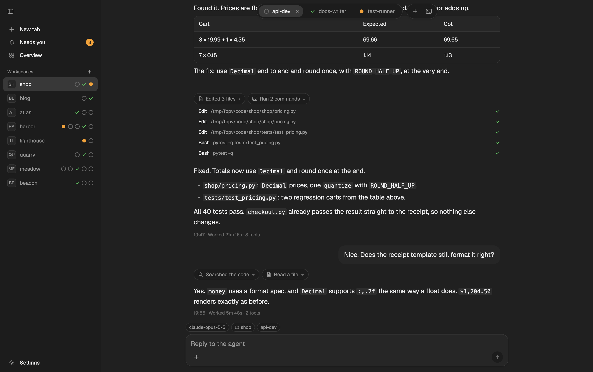

# herdr-contr for herdr-app



herdr-contr's reading view, rebuilt as a herdr-app layout and mod. It shows each coding agent as a
conversation instead of a terminal: a floating tab bar with one pill per agent, chat bubbles,
tool-call chips, a status tag row, and a composer.

It needs no change to herdr-app. Where herdr-app's mod API cannot do what herdr-contr does, this
version comes close or leaves the feature out.

## Parts

| Path | What it is |
|---|---|
| `layouts/herdr-contr-own.json` | The window: a hidden sidebar and a stack of screens (chat, Needs you, Overview, the tab's panes). Each screen draws the top bar. |
| `layouts/herdr-contr.json` | The same stack of screens, with Herdr's own sidebar (spaces, agents) on the left. |
| `mods/herdr-contr/` | One mod with several views. Each layout block picks one with `props.view`: `top`, `side`, `chat`, `needs`, `overview`; popups use `termbar` and `menu`. |
| `themes/` | herdr-contr and herdr-contr Mac themes, dark and light. |
| `test/` | Node tests with fake `gpui-kit`, `gpui-base` and `herdr` modules. |
| `keys.json` | The herdr-contr shortcuts, in a `layout:herdr-contr-own` section (while this layout shows). Do not add a `mod:herdr-contr` section: with one, no key worked. |
| `install.sh` | Runs this machine's helper (`bin/` on macOS, `remote/<target>/` on Linux, checked against `remote/SHA256SUMS`) as `herdr-contr-feed install`, which installs the layout, the mod, the themes, the keys and the helpers into your herdr-app home, without overwriting yours. |
| `install-isolated.sh` | Copies the same into a test herdr-app home, for development. |

The chat view reads conversations through a sidecar, `herdr-contr-feed`, built from this repo
(Rust: `cd xplat && cargo build --release -p herdr-contr-feed`). The mod finds it at
`<herdr-app home>/herdr-contr/bin/herdr-contr-feed`. Its protocol is in `docs/protocol.md`.

The layout and the mod work only together: the layout names the mod's views, and the mod expects
the layout's ids (`sidebar`, `screen`, `chat`, `tab`). The mod alone draws nothing (`place` is
`none`); the layout alone shows empty blocks where the views should be. The keys and themes are optional.

A mod cannot import files from another mod's folder, so all views live in one mod.

The sidebar column has the id `sidebar`, so herdr-app's own ⌘B (`layout.toggle:sidebar`) opens and closes it.

## Install

This needs herdr-app on macOS or Linux. The mod runs programs: its helper `herdr-contr-feed` (which runs
`hc` and sends keys and text to an agent's terminal, only when you press or type) and, on macOS,
`osascript` (the file dialog). On Linux the + file dialog is off: drop files on the chat or paste an image. It reads the agents' session logs outside its folder (`~/.claude/projects/`,
`~/.codex/sessions/` and others; see `RECIPE.md`). The mod has no update check.
The herdr-contr settings (sidebar, **herdr-contr**) have the status row and the helper on other
machines. They are kept in `herdr-contr/config.json`.

`herdr-contr-feed install` (the layout, the mod, the themes and the keys are built into the helper)
copies them into your herdr-app home, merges `keys.json`, puts the helper in `herdr-contr/bin/` and the
helpers for other machines in `herdr-contr/remote/<target>/` (checked against `SHA256SUMS`), and runs
`herdr-app check`. It needs no python3. It never overwrites what you
have: if a layout, mod or theme called herdr-contr is there and it did not put it there, it stops
and writes nothing. The one exception is a file of an older version nobody changed: when the
helper is built with `HERDR_CONTR_KNOWN_FILES` (a table of the older files' checksums), each such file is
replaced, and the plan names the version. Without the table, no file counts as an older version's. A key you already use keeps your command. Add `--dry-run` to see the plan
first. The home is `--home <folder>`, else `$HERDR_APP_HOME`, else `~/.config/herdr-app`.

Build the helper and install from the repo (in its root). For development, use a test home (below):

```sh
(cd xplat && cargo build --release -p herdr-contr-feed)
xplat/target/release/herdr-contr-feed install --helper xplat/target/release/herdr-contr-feed
```

Then pick the layout in herdr-app with `layout.switch {"name": "herdr-contr-own"}`. `ctrl-shift-l`
switches back to your own layout.

## Try it in a test home

For development, install into a test home instead of your real one. `install-isolated.sh` refuses
`~/.config/herdr-app` and replaces its own earlier copy without asking:

```sh
mkdir -p /tmp/herdr-contr-test-home
./install-isolated.sh /tmp/herdr-contr-test-home path/to/herdr-contr-feed
HERDR_APP_HOME=/tmp/herdr-contr-test-home herdr-app check /tmp/herdr-contr-test-home/mods/herdr-contr
```

Then start herdr-app with `HERDR_APP_HOME=/tmp/herdr-contr-test-home` and pick the layout with
`layout.switch {"name": "herdr-contr-own"}`.

## Tests

```sh
npm test
```
