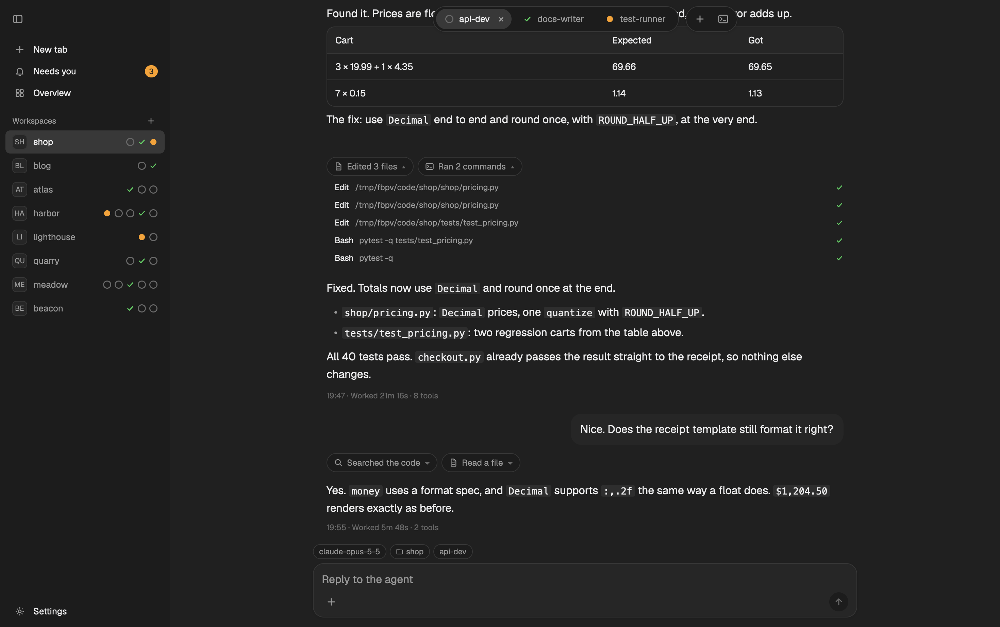

# herdr-contr

A reading view for coding agents. Each tab with an agent shows as a conversation instead of a
terminal: user messages in bubbles, the agent's replies as markdown with rounded code boxes and
tables, tool calls folded into chips, and a reply box under it. A floating bar at the top has one
capsule per tab with a status mark. When an agent asks for permission or asks a question, a card
above the reply box answers it. Needs you lists every agent that waits; Overview shows every tab as
a card. The sidebar is hidden and slides out from the window's left edge.



## What you see

The window has no title bar. The macOS window buttons sit at 18, 22. The theme is black and white
(`herdr-contr` dark, `herdr-contr-light` light); the Mac themes (`herdr-contr-mac`, `herdr-contr-mac-light`)
use blue `#007aff` for working, green `#34c759` for done and orange `#ff9500` for blocked.
Dark colors: the base colors are the same as `herdr-contr-mac`. The window shows `#202020` behind the
chat and the sidebar alike (the theme names canvas `#202020` and chrome `#1c1c1c`; the window paints
both `#202020`), raised `#262626`, hover `#2e2e2e`, selected `#383838`, text selection `#3a3a3a`,
border `#363636`, muted `#9a9a9a`, dim `#707070` (3.3:1 on the canvas, as before), accent and
foreground `#ededed`.

Left to right:

1. **Sidebar** (250 px, 220 to 320, hidden by default, `chrome` background, 1 px `border` divider).
   Top to bottom:
   - A 56 px header with a round 28 px sidebar button, at the same spot as the bar's sidebar button.
   - Rows, 30 px tall, 13 px text, a 22 px icon column: **New tab**, **Needs you** (an orange pill
     with the count when agents wait), **Overview**. The row for the shown screen is `selected`.
   - A "Workspaces" heading (11.5 px, semibold, muted) with a small + on the right.
   - One 34 px row per space: a 22 px monogram square (two letters, 10.5 px), the name, and the
     status marks of its tabs on the right (all up to 5, else the first 3 and "+N").
     Drag a row up or down to move the workspace (`space.move`): a 2 px `accent` line in the gap
     shows where it goes, the row dims, and the release moves it there. A move under 4 px is a
     click. Leaving the list, another mouse button or a press elsewhere cancels. The same in the
     floating sidebar. The tab drag in the top bar and this one share `drag.js`.
   - At the bottom, the plan usage: one 24 px row per plan with data, Claude then Codex (11.5 px,
     `muted`). The 22 px column has an 18 x 4 px meter (`border` track, `muted` fill) of the most used
     window; then the name; then each window in Menlo 10.5 px, `dim`: "5h 38% 2h · wk 12% 3d" (kind,
     whole percent used, time to its reset). A window past its reset shows 0%. The text clips at the
     right. The helper's `usage` command reads it: when the sidebar opens and every 5 minutes, off the
     UI thread, one read for all the views that show it. A plan with no data has no row.
   - Then a **herdr-contr** row (the herdr-contr settings dialog), and **Settings**.
2. **Work area**: a stack of four screens. The bar floats over the first three.
   - **Top bar** (56 px, over the content, no background of its own). The sidebar button (28 px,
     round, with a `chrome` backing) sits right of the window buttons while the sidebar is hidden.
     Centered: a tab capsule and a tools capsule, both 38 px tall, fully round, `chrome` with a 1 px
     border and a small shadow.
     - The tab capsule has one 30 px pill per tab that is not put away: a status mark, then the
       label (13 px, at most 170 px, cut with an ellipsis). The shown tab is `selected`, semibold,
       with a × to close it. The capsule scrolls sideways when the tabs do not fit.
     - The tools capsule has **+** (new tab) and a terminal button (the agent's terminal).
   - **Chat**: a reading column at most 1000 px wide, 24 px gutters, centered.
     - User message: a right-aligned bubble, at most 78% of the column, 16 px corners, `raised`.
       Its pictures under the text, 4 px below it: each 120 px high (the width from its shape, at most
       the text width), 8 px corners, a 1 px `border` frame, 8 px apart, side by side and wrapping.
       The helper's `pictures` writes them to `<herdr-app home>/herdr-contr/pics` (asked from the
       chat's timer, never while drawing). Until they are there, when they cannot be read (WebP, GIF,
       not in the log any more), and for an agent on another machine: "1 image" or "N images".
       A pasted image's path in the text (`herdr-contr/paste` under the app home, PNG or JPEG) is taken
       out of the text and drawn: one line of 120 px high pictures, each as wide as its image, cut at
       the text width. No helper call: the file is there. A path outside the app home stays text.
     - Agent reply: full-width markdown, 16 px text, 26 px lines (the `TextView` default; a mod
       cannot change it). Code fences are 12 px rounded boxes (`raised`,
       1 px border, Menlo 13 px, 21 px lines: one selectable `TextView` paragraph, so a drag selects across lines; right-click a box: Copy code, the box as written). Tables are 12 px rounded frames: a `raised` header
       row, 1 px lines between rows, columns sized to their content.
       In prose, pull request and issue references ("PR #51", "#51", "owner/repo#51", GitHub
       pull and issue URLs) are links (`refs.js`); a click opens them in the browser. A bare "#51"
       takes the repository of the agent's folder (`git remote get-url origin`, read once); without
       one it stays text. With the name of a known repository before it ("herdr-contr #51",
       "herdr-contr PR #51", "herdr-contr#51"), it takes that repository; the name stays text. Known: the
       repositories of all agents' folders in the app, each read once. Two with the same name: the one
       of the agent's own owner, else the agent's own repository. A name that no folder gives is asked
       on GitHub once for the app's run (`gh api repos/<owner of the agent's repository>/<name>`, from the
       chat's tick, at most 2 at a time); a yes makes it known and the rows draw again. Common words
       before a reference ("issue", "PR", "fixes", "see", "and" and others) are not asked. Code, links, other URLs, words and colors such as "#fff" stay as written.
       With **Inline PR icons** on (experimental, off by default; `inline.js`), a text block is cut at
       its paragraphs and top-level list items (`splitPieces`; an item with a nested list stays whole).
       Each piece with a reference is a wrapping row of plain elements (chat text size, line height
       and color; one child for each word, a 0.3 em gap between words). Each reference is a `Link`:
       GitHub's pull request or issue icon (Octicons, 14 px) colored by state, and the reference
       underlined; the `Link` opens it. Punctuation right after a reference stays with it. `**bold**`
       is bold (700), code is Menlo 14 px on `raised` with 4 px padding, other links are an underlined
       `Link`. No handler and no state: the chat's list renderer refuses them (#70). If the drawing
       throws, the block is the `TextView` and the error is logged once. State from `gh api` (at most 3 at once; open ones and
       failures read again after 60 s, closed ones kept), `muted` until known. Theme colors:
       `pr_open`, `pr_draft`, `pr_merged`, `pr_closed`, `issue_open`, `issue_done`,
       `issue_notplanned`. The states are read in the chat's timer, for the URLs that the shown rows
       drew. A list item's bullet or number is a 22 px
       column outside the row. The pieces without a reference between them stay one
       `TextView`. Each part is as tall as `markdownRaw` counts it, with the gap above it as top
       padding, so the row heights hold; a block with no piece drawn with icons is one `TextView`. Its height is the estimate's for the paragraph;
       when the icons would need one more line, the paragraph stays `TextView`.
     - Tool calls: a row of 28 px round chips ("Ran 3 commands", an icon per kind: terminal, doc,
       search, tool), each with ▾. A spinner while a call runs.
     - A pending call: a 28 px chip "Running · <what>" with a spinner.
     - Separators and footers in 11.5 px dim text.
     - A round 34 px ↓ button at the bottom center while you read older messages.
     - "Loading earlier messages" in a small capsule under the bar while older rows load.
   - **Reply box** under the chat, at most 800 px wide (#99). Above the box, 8 px over it, one status line (gap
     8, 4 px side padding): while the agent works, a 14 px braille loader in `foreground`, the working verb (13 px,
     `foreground`) and its detail with no parentheses (Menlo 11 px, `muted`: "26s · ↓1.5k tokens"); then Claude
     Code's background note ("1 shell still running", Menlo 11 px `muted`, also while the agent is idle, with its own
     loader then; it truncates first); on the right contr's orchestration as plain Menlo 11 px `muted` text. The box:
     12 px corners, 1 px `border`, `raised`; padding 12 top, 10 right, 8 bottom, 14 left; 10 px between the text
     and the bottom row. The text is 14 px on 20 px lines; the placeholder is "Reply to <agent name>". The bottom
     row (gap 4): + (28 px square, 8 px corners, 16 px icon, hover fill; macOS only), the model button (28 px
     high, 8 px corners, 8 px side padding, gap 6, hover fill: the agent's 13 px mark in the program table's tile
     color, the short model name "Fable 5.2" at 12 px, the effort in `muted`, an 11 px `muted` chevron), a
     spacer, the context (a 14 px ring: `border` track, `muted` arc from 12 o'clock in 5% steps, then the percent
     in Menlo 11 px `muted`; a warning is `blocked` on both), the branch (13 px icon and name, Menlo 11 px
     `muted`, truncated), and the 28 px send button (8 px corners, 4 px left margin; `chrome` fill and `dim`
     arrow when empty or sending, else `accent`). The model comes from the helper's `model` (asked with the
     status, at most every 15 s), else the status line's tags; not known yet, the button shows the app's name
     alone. Its tooltip: "Opus 5.5 · medium effort · Claude Code" and the folder; the context's: "149k of 250k
     tokens · auto-compact at 250k" (the limit is Claude Code's `autoCompactWindow`), else "37% of the model's context window". A press on the model button in Claude Code puts `/model ` in the box (nothing is sent). No tags
     row under the box. File chips above the text: a PNG, JPEG
     or SVG under the app home (a pasted image is in `herdr-contr/paste`) shows as a 56 px high picture
     (8 px corners, `border` frame, × on its top right corner); any other file, and an image from another
     folder, is a chip with its name.
   - **Tab panes**: a split tab, or a tab with a shell, shows its own panes (a 56 px top bar
     above them, 8 px padding, 6 px gaps, 8 px corners, 1 px border, `muted` border on focus).

Orchestration: at the right end of the status line above the reply box, "Orchestrating · N workers" as
plain text when the agent's terminal has the hc label `contr.orchestrating` or live child terminals; else, for
Claude Code, a quiet "Orchestrate" that puts `/contr:orchestrate ` in the box.

Status marks: working is a 13 px braille loader (`working` color: ⠋⠙⠹⠸⠼⠴⠦⠧⠇⠏ in Menlo, 80 ms a frame,
drawn by Herdr's `frames`; every loader of the mod is this one); done is a check
(`done`); blocked is a 9 px dot (`blocked`); idle is a 12 px empty ring (`dim`).

## How it behaves

- **Tabs**: click a pill to show that tab. A tab with one agent shows the chat; a split tab or a
  shell shows its panes. Right-click a pill: Rename…, Move left, Move right, Open terminal,
  Show chat or Show panes, Split right, Split down, Put away, Close tab. Drag a pill to move its
  tab: a line shows where it goes, and the release moves it there. Dragging out of the bar
  cancels (the tab stays), and so does another mouse button. Esc does not cancel: the bar does
  not take the keyboard from the chat or the terminal.
- **Chat**: opens at the newest message and follows new ones. Scrolling up stops following; the ↓
  button goes back to the end. Older messages load only when you scroll up past the first row.
  A click on a tool chip opens its calls (name, summary, a check, a spinner, or "failed").
  Another agent's chat fades in.
- **Reply**: Enter sends (the text area's submit). Drop files on the chat or click + (the
  macOS file dialog; on Linux and Windows there is no +, since a mod has no file picker) to attach them. ⌘V (Ctrl+V on Linux): files copied in Finder or a file manager are attached; else
  plain text is typed (also when a picture comes with it, as from Excel, Numbers or Word); else an image (a
  screenshot, a browser's Copy Image) is attached as a PNG.
  If the text did not go out, it stays in the box with a red note. "Sent. The agent did not
  confirm it yet." when the core did not answer in time.
- **Approval card**: 1 allows once, 2 denies (with the card focused). After an answer the buttons
  turn off and the card says "Answer sent. Waiting for the agent." until the prompt leaves.
  "It changed on screen. Here is what it shows now." when the prompt on screen is another one.
- **Question card**: 1-9 picks an option (a one-choice pick moves on); the number after the
  options moves the keyboard into the own-answer box; Enter goes on or sends. With more questions
  behind the first: **Show all N questions** reads them all from the agent's picker. Claude's
  preview layout (an option with a `preview`): the box on the right is not read, the card has no
  own-answer row (`noOther`), and Send moves the focus with Up or Down to the pick, then presses
  Enter.
- **Orchestration settings**: contr's agents.json, the file contr's coordinator reads. The path is
  `CONTR_AGENTS_CONFIG` when set (read through `sh`, as the mod has no environment), else the user
  config folder's `contr/agents.json` (macOS `~/Library/Application Support`, other systems
  `$XDG_CONFIG_HOME` or `~/.config`). The values and defaults are contr's (`internal/agents`: Flow,
  DefaultConfig): flow `when-needed`, `code`, 2, 4, `ask`; orchestrator opus medium, builder sonnet
  medium, planner and reviewer opus low, debugger opus xhigh. A change reads the file, sets one field
  and writes it against the text just read: all other keys stay; the flow is written whole; a
  role sets `--model` or `--effort` in its `argv` (a missing `--effort` goes after `--model`), and the
  rest of the command stays. claude is the first argument whose base name is `claude`, after an
  optional `env` with `NAME=value` arguments; a command that is not claude is never replaced and its
  switches are off. A missing file shows the defaults;
  the first change creates it (and its folder). A file that is not JSON shows an error and is never
  written.
- **herdr-contr settings** (the herdr-contr row, or ⌘⇧,): saved in `<herdr-app home>/herdr-contr/config.json`
  as `{"status_row": "show", "remote_helper": "ask"}`. The install never
  creates the file; a missing file or key is the default, and so is a value that is not one of the
  choices. A file that is not JSON is the defaults too: the dialog says so, and its switches do
  nothing until the file is fixed or removed (it is never overwritten). A change keeps the other keys,
  is written against the text just read (someone else's change is read again, not lost), and every
  view shows it at once. The file is read again each minute and when the dialog opens.
  - **Inline PR icons (experimental)** On: icons before pull request and issue references in prose (see the chat).
  - **Status row** Hide: no model button and no context ring in the reply box (the branch and the status line stay).
  - **Helper on other machines** Never: for a tab on another machine the chat says, in one line,
    "herdr-contr does not run its helper on other machines. To change it: herdr-contr settings, Helper
    on other machines: Ask." No install card; the tab menu has "Remove helper: choose Ask in herdr-contr
    settings first…" (it opens them) in place of Remove helper; and the helper
    itself refuses every command for a terminal there and `helper install` / `remove` (`remote-off`). To remove a helper that is
    already there, choose Ask first.
  - **Phone page** On: the helper (`phone on`) writes the phone page's user service (a launchd agent
    on macOS, a systemd user unit on Linux, from `serve --print`, marked as herdr-contr's) and loads
    it, so it keeps running after Herdr app quits and starts at login. Off stops it and removes that
    one file. A service set up by hand (SERVE.md) has no marker: the section says so and leaves it.
    No Tailscale: On cannot be picked. The login and Read-only apply at once (the service is written
    again). The port is config.json `phone_port` (8787), not in the dialog: for a port already taken.
    herdr-contr never changes Tailscale settings; it shows the Serve command. An install that replaces
    the helper restarts this service. While the dialog is open it asks the helper again every 10 s.
- **Sidebar**: ⌘B or the sidebar button shows and hides it. With it hidden, the pointer at the
  window's left 4 px slides it out as a floating panel (260 px wide, 8 px from the edges, 14 px
  corners, a large shadow), which closes when the pointer leaves it, on Esc or a click beside it.
  Right-click a space: New tab here, Rename…, Close workspace….
- **Agent's terminal**: ⌃` or the terminal button opens the agent's real terminal in a floating
  window (70% of the window, 16 px corners) with a 42 px title bar (a terminal chip, the name,
  "Terminal", a round close button). ⌃` again closes it.
- **Chat | Terminal switch** (`herdr-contr` layout): a tab with an agent shows a switch on the right
  of a 36 px strip, over the chat and over the tab's terminal (block `view-switch`, view `switch`).
  ⌘J (and ⌘⇧T) does the same; each side's tooltip names ⌘J ("Chat (⌘J)"). The tab keeps the pick. A tab
  without an agent hides the block.
- **Main agent keys** (#117): ⌃1-⌃9 show the 1st-9th main agent (an agent that is not a worker of another)
  in the order of the sidebar's Projects list: this computer's projects first, then each other machine's by
  name; in a machine, the spaces in order; in a space, the agents in order. Workers have no number. A number
  with no agent does nothing. The key runs `agent.focus` and the tab's screen follows the tab's pick. The
  order is in `mainagents.js`, with one copy in `herdr-contr` and one in `herdr-contr-spaces` (a test keeps
  them equal). These keys win over Herdr's global ⌃1-⌃9 (`space.select`) while this layout shows.
- **Keys** (while this layout shows): ⌘T new tab, ⌘W close tab, ⌘⇧N new space, ⌘1-⌘9 a tab,
  ⌘⇧[ / ⌘⇧] or ⌃Tab / ⌃⇧Tab the tab before or after, ⌘⌥↑ / ⌘⌥↓ the space before or after,
  ⌘⌃⇧← / ⌘⌃⇧→ move the tab, ⌘⇧I Needs you, ⌘⇧\ Overview, ⌘B sidebar, ⌃` terminal, ⌘J or ⌘⇧T chat or terminal, ⌃1-⌃9 a main agent,
  ⌘= / ⌘- / ⌘0 zoom, ⌘, settings, ⌘⇧, herdr-contr settings, ⌘/ help. In the herdr-contr settings,
  Tab moves through the sections, then the choices, and Enter or Space picks one.

## Built from

- **Layout** `layouts/herdr-contr-own.json`: a `row` (`titlebar: "none"`, `traffic_lights: [18, 22]`,
  background `canvas`, theme light `herdr-contr-light` / dark `herdr-contr`) with:
  - `sidebar`: a `column`, 250 px (min 220, max 320), `hidden`, `chrome`, a 1 px divider, holding
    one block `side`.
  - `work`: a `column` holding the `stack` `screen` (active `chat`) with the blocks `chat`,
    `needs`, `overview` (each `window_drag`) and the `column` `tab`: the block `top` (56 px) above
    `tab-panes` (`content: {tab: "active", pane: {gap 6, radius 8, border 1 border, focus 1 muted}}`,
    padding 8).
  - The ids `sidebar`, `screen`, `chat` and `tab` are what the mod switches.
- **Layout** `layouts/herdr-contr.json`: the same `work` column and theme, but `sidebar` is
  Herdr's, as in Herdr's `main` layout (268 px, shown: the blocks `workspace-chrome`, `projects` (mod
  `herdr-contr-spaces`, the Projects list) and the `workspace-chrome` footer), with `traffic_lights: [12, 16]`. Between the list and
  the footer is the mod's `usage` block (56 px, view `usage`): the same plan usage rows as the mod's own
  sidebar. It starts hidden; the mod shows it (`layout.show`) when a plan has data and hides it when none
  has. The chat, Needs you and Overview screens start the reads too, so the hidden block can show. Under it, just
  above the footer, is the mod's `settings-row` block (32 px, view `settings-row`): one row as Herdr's footer rows
  (28 px, 8 px in, 14 px `sliders` icon, label "herdr-contr", muted, hover background) that opens the herdr-contr
  settings dialog. On hover it shows the key `⌘⇧,` at the right. On the rail (sidebar under 160 px) it is the icon
  only, with a tooltip. The mod knows it by
  `shared("layout") === "herdr-contr"`: there the left edge opens no floating sidebar, the
  sidebar shows unless `layouts/.state/herdr-contr.json` hides it, and the bar leaves no room
  for the window buttons while the sidebar shows. ⌘B hides and shows Herdr's sidebar. The top bar
  is Herdr's own too: the `work` column is the `tabs` block (mod `herdr-contr-tabs`, 42 px, `window_drag`) above a
  `work-body` row with the `screen` stack and Herdr's `panel` (368 px, hidden: `files` and
  `changes`), as in `main`. Herdr's bar has the tabs, + and the Files and Changes buttons; a tab
  picked there shows its chat or its terminals (the screen sync). The `tab` column holds only
  `tab-panes`. With a `tabs` block in the layout (`herdrTabBar()`), the chat, Needs you and
  Overview draw no bar and leave no room for one (`barH()` is 0); Needs you is ⌘⇧I and Overview
  ⌘⇧\.
- **Mod** `mods/herdr-contr-tabs/`: a copy of Herdr's `tabs` mod (Apache-2.0). The one change: the working
  mark is the braille loader of `mods/herdr-contr/state.js` (12 px, ⠋⠙⠹⠸⠼⠴⠦⠧⠇⠏ in Menlo, `line_height(1)`,
  80 ms a frame), in place of the turning arc. A mod cannot import another mod, so each copy has its own
  `loader()`. The copy keeps its window icons (`win-*.svg`); the icons of other Herdr mods (`workspace-chrome`,
  `pane`, `files`, `changes`) stay where Herdr installs them. The copy of Herdr's `agents` mod went in #98: the
  Projects list draws the agents, and the install removes an installed copy that nobody changed.
- **Mod** `mods/herdr-contr-spaces/`: a copy of Herdr's `spaces` mod (Apache-2.0). It is the **Projects list**
  of the `herdr-contr` layout (#96; after the owner's design, slice 1 of 3). The layout no longer names
  the agents copy: the agent rows are drawn here (`projects.js` holds the grouping).
  - A head row "Projects" (12 px, `font_medium`, `muted`; padding 6 10 4 20) with a 24 px + (8 px corners, `space.new`).
    The list: 10 px at the sides, rows 2 px apart, 10 px under each project and its agents.
  - A project row (30 px, 8 px corners, padding 0 10 0 6, gap 6): a 14 px chevron (only when the project has
    agents; a press on it opens or shuts the project's agents, kept in `localStorage` `projects.closed`, and is no
    select or drag), the favicon or the folder (16 px), the name (13 px, `font_medium`), the branch (Menlo 11 px,
    `muted`), and at the right the commits ahead and behind (`↑2`, `↓4`, Menlo 11 px, `muted`). A shut project
    shows its agents' state marks (13 px) before them. The row is `selected` only for the shown space when no
    agent row of it shows. A click selects the space, a right-click opens its menu (rename and the others), a
    drag moves it, as before. Worktree rows stay under their checkout.
  - Under an open project, its agents (`agents()` with that `space`). A row (8 px corners, padding 6 10 6 26,
    gap 8): the agent's icon (15 px; a tinted glyph takes the state's color; 45% opacity except on the shown
    row), the title in one line (13 px; a named tab, else the agent's own title, never a tab number), the age
    since its state changed (Menlo 11 px, `muted`; not while it works) and the state mark (15 px; only while it
    works or waits). The shown agent's row is `raised` with a 1 px `border` ring, its title `foreground` 500; a
    done agent not looked at yet is `foreground` 600; any other is `muted` 400. A click focuses its pane.
  - State marks (Menlo): working the braille loader in `foreground`, waiting for the owner `⠿` in `blocked`
    with a pulse (opacity 0.35 to 1, 1.4 s), idle `⠶` and done `✓` in `muted`.
  - An orchestrator is an agent with live sub-agents: hc gives each terminal its `parent` (`terminals()`), the
    same data the agents copy used for sub-agents. Under its title: "Orchestrating · N workers" (12 px,
    `muted`); N counts all its live sub-agents, depth first. Under it, its workers in a block 32 px in, 9 px
    padding, with a 1 px `border` guide line at the left, rows 2 px apart: a 26 px row (6 px corners, padding
    0 8, gap 8) with the icon (13 px), what it works on (12 px; its name, else its template or program;
    `muted`, `dim` when done, `foreground` when shown) and its state mark (12 px). A deeper sub-agent is 14 px
    further in. The shown worker's row is `raised`. A click focuses its pane, or peeks a worker without one. A
    sub-agent with a pane is in `agents()` too and shows only under its parent.
  - The projects with no agent go into one closed row at the end of each machine's group, "N more projects,
    no agents" (30 px, a 14 px chevron, 12 px `muted`). Open (in memory), it lists them as project rows. The
    shown space is never in it; a checkout and its worktrees go there only together.
  - Herdr's agent order (`setAgentOrder`) is the projects' order, shut projects included.
  - Hover (#98, slice 3): on an agent row under the pointer (`on_hover`, kept in the view; the row is drawn
    again), the age and the state mark hide, the icon is at full opacity, and two buttons show at the right
    (absolute: top 4, right 6, gap 2): Stop (`terminal.kill`) and "Open in a new tab" (`terminal.keep` with
    `place: "tab"`). Each is 22 px square, 6 px corners, a 12 px icon in `muted`, `hover` fill, with a tooltip.
    A press on one is not a press on the row.
  - The model tooltip: an agent row and a worker row have the tooltip "Opus 5.5 · medium effort" (Herdr's own
    tooltip: its look and place are the shell's). It comes from the helper's `model` command
    (docs/protocol.md), asked only when the helper has it, from a timer (at start, then every 15 s) and never
    from a draw: for a terminal the first time it shows and when its status changed, at most once in 15 s.
    No model known: no tooltip. A main agent's row adds its key at the end: "Opus 5.5 · medium effort · ⌃1",
    or only "⌃1" with no model (#117). A worker row has no key. The key is not drawn on the row while ⌃ is
    held: `on_modifiers_changed` fires only on the keyboard focus path, and the focus is in the chat or the
    terminal, not in the sidebar.
  - The rail (under 160 px) and the machine group rows are as before. The agents copy's pin and sort menu are
    not here: the owner's design has neither.

  The favicon change: the
  space icon (18 px) is the project's favicon (`image()`, full color, 4 px corners), else a folder icon
  (`workspace-chrome/folder.svg`, 15 px, `muted`), in place of the colored letter. Worktree rows keep
  the branch icon. Only spaces on this computer look; a space on another machine shows the folder. The
  look is one `exec` of `sh` in the space's folder (its first terminal's folder, else where it was
  made), off the UI thread, on the 250 ms check the mod has already. Its result is kept per folder, so
  a folder is looked at once, and again only when the space moves to a new folder. Files only, the first
  found wins: `favicon.svg`, `favicon.png` in the folder, then in `public/`, `static/`, `app/`,
  `src/app/`, `assets/`, `web/`; then `apple-touch-icon.png`, `icon.png`, `icon.svg` in the same folders.
  No `.ico`: `image()` names SVG, PNG and JPEG, not ICO.
- **Mod** `mods/herdr-contr/` (`mod.json`: `place: "none"`): one mod, one view per block, picked
  by `props.view`: `side`, `chat`, `needs`, `overview`, `top`; overlays use `settings` (the herdr-contr
  settings dialog), `termbar` (the terminal window's bar), `menu` (right-click menus) and `side` with `peek: true` (the floating sidebar).
  All views are in one folder because a mod cannot import another mod's files.
- **Shared state** (`shared` / `setShared`): `herdr-contr.agent` (the agent shown),
  `herdr-contr.screen` (the shown screen; an old `settings` shows the chat), `herdr-contr.settings` (the
  open settings dialog), `herdr-contr.sidebar`, `herdr-contr.sidebar.peek`,
  `herdr-contr.terminal`, `herdr-contr.window.height`, `herdr-contr.command`, `herdr-contr.overview.group`,
  `herdr-contr.config` (the settings file, parsed).
- **herdr functions**: `spaces`, `agents`, `panes`, `focused`, `theme`, `layout`, `window`,
  `settings`, `props`, `run`, `nextCommand`, `setAgentOrder`, `openOverlay`, `closeOverlay`,
  `exec`, `appHome`, `home`, `readTextFile`, `writeTextFile` (config.json only).
- **Commands it runs**: `layout.select {stack: "screen", child}`, `layout.show` / `layout.hide
  {id: "sidebar"}`, `tab.select`, `tab.close`, `tab.move`, `tab.rename`, `tab.settle`, `tab.new`,
  `pane.split`, `space.select`, `space.new`, `space.rename`, `space.close`, `agent.focus`,
  `app.settings`. Its own key commands: `herdr-contr.terminal`, `herdr-contr.view`, `herdr-contr.needs`,
  `herdr-contr.sidebar`, `herdr-contr.overview`, `herdr-contr.settings`, `herdr-contr.move-left`,
  `herdr-contr.move-right`, `herdr-contr.main-1` … `herdr-contr.main-9`.
- **Shipped mods**: `new-menu` (the + popup, 250 × 512).
- **Programs**:
  - `herdr-contr-feed`, a helper program at `<herdr-app home>/herdr-contr/bin/herdr-contr-feed`
    (make it executable). The gallery copies only `layouts/` and `mods/`, so get the helper on its
    own: build it in this repository with
    `(cd xplat && cargo build --release -p herdr-contr-feed)`, then run
    `xplat/target/release/herdr-contr-feed install --helper xplat/target/release/herdr-contr-feed`. It reads each agent's session log
    (`~/.claude/projects/`, `~/.codex/sessions/`, `~/.grok/sessions/`, `~/.cursor/projects/`,
    `~/.pi/agent/sessions/`, `~/.gemini/antigravity-cli/`) and talks to herdr-core (`hc`) to read
    screens and send keys and text. Commands: `feed`, `status`, `card`, `approve`, `answer`,
    `send`, `paste-image`, `pictures`, `helper`, one per `exec`, JSON Lines back
    (`herdr-app/docs/protocol.md` in that repo). Every call ends with `--home <herdr-app home>`, so
    the helper follows the same config.json. It keeps `<herdr-app home>/herdr-contr/cache.json`, `answered/` beside it, and pastes in
    `<herdr-app home>/herdr-contr/paste/`.
  - `osascript`, for the file dialog (macOS only; the + button shows only when `window().platform` is `macos`).
  - It reads `<herdr-app home>/layouts/.state/<layout>.json` once (`herdr-contr` or `herdr-contr-own`), for whether the sidebar was open.
- **Themes** `themes/herdr-contr.json`, `herdr-contr-light.json`, `herdr-contr-mac.json`,
  `herdr-contr-mac-light.json`.
- **Keys** `keys.json`: the sections `layout:herdr-contr-own` and `layout:herdr-contr`, with the same keys.
- **Art** `mods/herdr-contr/icons/`: arrow-down, bell, branch, check, close, doc, folder, gear, grid,
  plus, search, send, sidebar, sliders, split, terminal, tool (16 × 16 SVG, 1.8 px round strokes, `currentColor`).

## Watch out

- The mod alone draws nothing, and the layout alone shows empty blocks. Copy both, and the themes
  the layout names.
- Without the helper, the chat says "The herdr-contr helper is missing. Build it:
  cargo build --release -p herdr-contr-feed (in xplat), then herdr-contr-feed install --helper <it>." Every other view still works.
- Tell the person before adding it: the mod runs programs (`exec` of the helper and `osascript`;
  the helper runs `hc` and sends keys and text to agents' terminals, only on a press or a key), and
  reads files outside its folder: the agents' session logs (`~/.claude/projects/`,
  `~/.codex/sessions/` and the others under Programs) and `<herdr-app home>/layouts/.state/`.
- The mod and the helper do not check for updates.
- Do not add a `mod:herdr-contr` section to `keys.json`: with one, no key worked.
- Flockbook, the mod this one comes from, can be installed in the same Herdr home. No file,
  folder, layout, theme, key section, command or shared key has the same name, so neither install
  touches the other (`xplat/herdr-contr-feed/tests/flockbook.rs`).
- ⌘V in the reply box: the text box's own paste runs before any `on_key_down`, so a key handler never
  sees it, and a Finder copy (file names as text) came in as names. The mod binds `secondary-v` with
  `cx.bind_keys` under its own key context (`HerdrContrComposer > Input`), asks `paste-image` first
  (files, then plain text, then an image), and types the text itself when nothing is attached.
- A `TextareaState` has no placeholder setter, and a state can not be made while drawing. The reply box
  makes a new state in the chat's tick when the agent's name changes ("Reply to <name>"), moves the text
  into it, gives it the keyboard when the old one had it, and releases the old one.
- `layout()` is the file, not the live tree. Keep the shown screen and the sidebar state in shared
  state, and select the screen outright.
- A mouse move carries no button state and arrives only over the element under the pointer, so
  a release outside the bar is never seen. The tab drag ends when the pointer leaves the bar.
- Each screen draws its own top bar, so each copy runs the bar's work. Two copies can get one key
  command: the first acts, and the others skip it within 150 ms (`herdr-contr.command`).
- The chat is a `v_virtual_list` with guessed heights (16 px text, 26 px lines, the `TextView`
  default that a mod cannot change; wide letters counted as 16 px, the rest 0.5 × 16, one
  letter of width kept free), because `list` cannot be scrolled from code and the chat
  must open at the end. A guess too low cuts a row; guesses lean high.
- A code box's `TextView` keeps leading spaces only as no-break spaces (markdown drops plain ones), so text
  selected and copied with ⌘C has no-break spaces in its indent. Copy code (right-click) copies the source.
- A virtual list row takes no handlers, and `on_item_click` gives no position: a button inside a row cannot
  be told from a press on the text. `on_item_secondary_click` gives the press against the row; the chat finds
  the code box under it from the same estimate as the row heights.
- A code block with the language mermaid is a diagram (mermaid.js, #87): the helper's `mermaid` draws it to an
  SVG under `herdr-contr/mermaid` in the app home, in the theme's colors (dark when the background's luminance
  is under half). Render only reads the answers (a Map by text) and notes the blocks it drew; the chat's tick
  asks the helper for them, two at a time. The image is in the code box's frame, at its own size or scaled
  down to the text width; estimate.js counts the same height, and a new answer makes the chat measure its
  rows again. Until the answer is there, or when the helper cannot read the text, it is the code box.
- `TextView.markdown` takes no style and draws code and tables square. Split the text into blocks
  and draw fences and tables yourself. A `TextView` in a flexible cell keeps its one-line width
  and spills out: give table cells a fixed width.
- `openOverlay` with `at: "pointer"` uses a pointer position that is not updated while the pointer
  is over an overlay window. The floating sidebar opens its menus at the press's own position.
- A popup sizes to its content and ignores a height. The floating sidebar is a frameless `window`
  overlay sized from the window height the views note.
- Keys go out only on a press or a key, never on a timer. The helper checks the screen again right
  before every key: a prompt that changed sends nothing. One approval goes out once per prompt.
  A reply goes only to the agent and conversation the chat showed.
- Esc goes to the terminal in the terminal window, so its title bar has the close button.
- Built and tried on macOS only. The helper needs herdr-core running; agents it reads: Claude
  Code, Codex, Grok Build, Cursor, pi, Antigravity CLI.

## Done when

- `<herdr-app home>/herdr-contr/bin/herdr-contr-feed version` prints a JSON line with `"protocol"`.
- `herdr-app check mods/herdr-contr` passes, and `layout.switch {"name": "herdr-contr-own"}` shows the bar
  with one pill per tab of the shown space, each with its status mark.
- A tab with a Claude Code agent shows its conversation, at the newest message, and a new reply
  from the agent appears without a click.
- A reply with a code fence and a table shows a rounded code box and a rounded table whose text
  stays inside its cells.
- A reply with a ```mermaid flowchart or sequence diagram shows the diagram in a rounded box, readable in a
  dark and a light theme, no wider than the text; the rows under it do not overlap it.
- Typing in the reply box and pressing Enter puts the text into the agent's terminal.
- ⌘V in the reply box after copying a file in Finder attaches the file (no name typed); after a
  screenshot to the clipboard it attaches a PNG; after copying text it types the text at the cursor.
- A Claude permission prompt shows the approval card with the same command; 1 allows it once, and
  the buttons turn off until the prompt leaves.
- A question picker shows the question card; picking and Send answer answers it in the terminal.
- ⌘⇧I shows Needs you with the waiting agents; ⌘⇧\ shows Overview with every tab.
- With the sidebar hidden, moving the pointer to the window's left edge slides out the floating
  sidebar, and it closes when the pointer leaves it.
- ⌃` opens the agent's terminal window; ⌃` again closes it.
- Dragging a pill onto another pill moves that tab there, also with the bar scrolled; dragging it
  out of the bar and releasing moves nothing.
- Dragging a workspace row onto another row moves that workspace there, in the docked and the
  floating sidebar; dragging it out of the list and releasing moves nothing.
